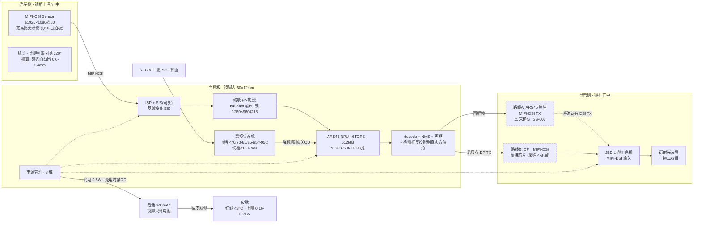

# 系统架构图 / 信号流 / 数据流 (ISS-021)

> 生成 2026-10-25 | 关联: `PROJECT_TRACKER.md` §1/§2, `INTERFACES.md`, 三份 HANDOFF
> **每个数值都能指到来源**。标 `[推算]` = 纸面估算, 标 `[0数据]` = 实测值为空。
> ⚠️ 关键分叉: **显示 TX 接口未确认** (ISS-003) → 图中画两条路, 不假装只有一条。

---

## 1. 系统架构 (数据流 + 信号流)



### 显示链路线选择 (ISS-003 未定, 但不阻塞)

| | 路线 A (原生 DSI TX) | 路线 B (桥接芯片) |
|---|---|---|
| 前提 | 原厂书面确认 ARS45 有 DSI TX | 原厂确认只有 DP TX |
| 额外硬件 | 0 | +1 颗桥接芯片 (<100mW, <10ms) |
| 采购 | — | **4-8 周** → 并行询价 (草稿保留未发) |
| 当前动作 | 等原厂 | 草稿就绪, 说发就发 |

> **原理图对策已是双出口** (DSI_TX / DP_TX 都留, 走 0Ω/DNP) → **PCB 出板前再定用哪条**, 不阻塞。

---

## 2. 端到端时延链 (口径 A = 曝光开始 → 出光)

> 完整推导: `DECISION_TABLE_Q1_Q4_Q17.md` · 框龄是台阶函数 `age = ceil(T_od / 16.67ms)`

| 环节 | 值 | 证据 | 来源 |
|---|---|---|---|
| 曝光 | 24.67ms | [推算] | 决策表 |
| ISP + 缩放 | [推算] | [推算] | sw-lead |
| **NPU 纯硬件** | **≤16.67ms 才达标** | **[0数据]** | ⚠️ 待 M-NPU 实测 |
| decode + NMS | [推算] | [推算] | sw-lead |
| 框龄 | age × 16.67ms | [推算] | 公式 |
| 光机逐帧延迟 | **未测** | **[0数据]** | ⚠️ 老板 19:23 定: 改主观眩晕验收 |
| 显示帧率 | 60fps 优先 (兜底 30) | 已拍板 | Q17 |

**达标路径 (唯一)**: `T_od ≤ 16.67ms` → age=1 → 端到端 **50.3ms ✅**
**兜底**: age=2 → 67.0ms ❌ → **两件一起切** (显示槽位 60→30Hz **且** 合成策略 异步→等OD) → **55.7ms @ 25.6fps ✅**

---

## 3. 信号流 (I2C / 中断)

| 链路 | 主机 | 从机 | 关键约束 |
|---|---|---|---|
| I2C #1 | 主控 | Sensor | 地址由 sensor 厂定 |
| I2C #2 | 主控 | 走鹃Ⅱ 光机 | **DSI DDC 地址必须可配, 避免与 sensor 冲突** |
| I2C #3 | 主控 | NTC (贴 SoC 背面) | ≥1Hz (建议 5Hz), 报 Tj 即可 |
| I2C #4 | 主控 | 桥接芯片 (路线B) | 地址需可配 |
| USB 2.0 | 主控 | PC (烧录/调试) | 路线B 才有; 路线A 需原厂调试口 |

---

## 4. 数据流 (软件侧)

```
capture(sensor) → ISP → scale → [q_frame] → OD worker(pre_process/NPU/decode/NMS)
   → [q_result] → draw → display frame
```
- **框龄模型**: OD 永远算最新帧 (q_frame max=2, drop oldest) → 不隔帧检测
- **★鱼眼 + 不裁剪 的副作用**: 检测框在图像上是**弯的** → 框位置与**框龄**必须用**反投影后的方位角**, 否则带系统性误差 (框龄直接决定 age=1/2 → 50.3 vs 67.0ms) → ISS-053
- **按需触发**: 唤醒 → OD 开 → 超时休眠 (Q4 = 按需触发, 已拍板)
- **温控**: NTC → Tj → 4 档 → 切档 ≤16.67ms (60fps 时只有 1 帧余量)
