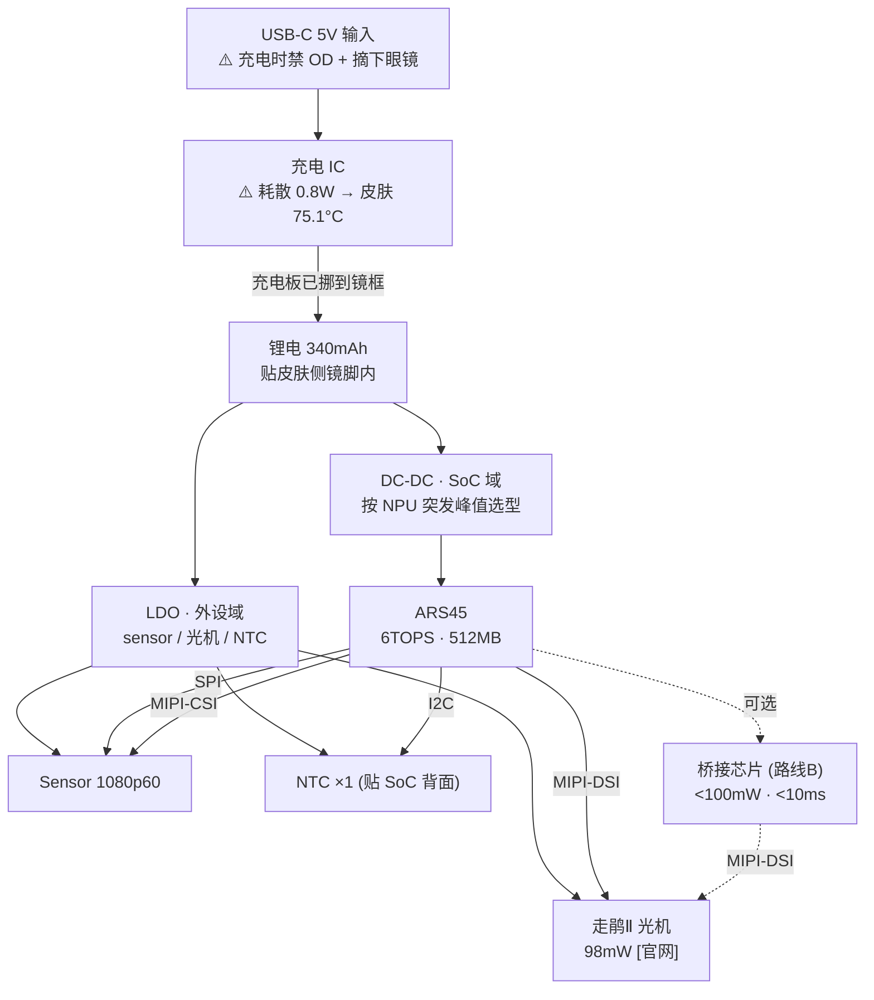

# 电源拓扑图 (Power Tree) (ISS-021)

> 来源: `HW/HARDWARE_BREAKDOWN.md` §1.2 电源树 + `MECH/MECH_BUDGET.md` §2.3/§2.3.1 + `SW/SW_REQUIREMENTS.md` M7
> ⚠️ **各轨的标称电压/最大电流全部未知** —— 原厂电源域表未到 (ISS-007)。本图是**拓扑意图**, 不是可出图的设计。

---

## 1. 拓扑



---

## 2. 热账 (ISO 13732-1 硬红线: 皮肤 8h+ 接触 **43°C**)

| 场景 | 整机功耗 | 皮肤侧温升 | 皮肤侧温度 | 判定 |
|---|---|---|---|---|
| 持续满载 | 1.22W | +61.1°C | **96.1°C** (变体 82.0) | ❌❌❌ |
| **按需触发 (均值)** | **0.23W** | +11.5°C | **46.5°C** (变体 43.9) | ❌ 超红线 3.5°C |
| 待机 (地板) | **<0.05W** | +2.5°C | **37.5°C** | ✅ |
| 43°C 对应的持续上限 | **0.16-0.21W** | — | 43.0°C | ← 真正的设计上限 |
| 充电 (系统关机) | 0.8W | +40.1°C | **75.1°C** | ❌❌❌ → 必须摘下 |
| 充电 + 满载 | 2.02W | +101.3°C | **136.2°C** | ❌❌❌❌ 物理不成立 → 必须禁 OD |

**模型不确定性 ±14°C** (壳壁热阻算不算进皮肤侧) → **必须样机贴片热电偶实测** (M-SKIN / M-CHRG)

---

## 3. 已拍板的散热三件套 (老板 19:23)

| # | 措施 | 效果 | 状态 |
|---|---|---|---|
| 1 | **SoC + 充电板挪到镜框** | 镜脚只剩电池 → 皮肤侧 **37.5°C** ✅ | 硬件/结构需跟 (ISS-049/052) |
| 2 | **充电时摘下眼镜 + 禁 OD** | 避开 75-151°C 场景 | 软件需实现门禁 (四重验证, 含旁路) |
| 3 | **待机功耗 <0.05W 硬约束** | 待机皮肤 37.5°C ✅ | SW 低功耗策略 (ISS-029) |

**❌ 已被排除的方案**
- 加散热片 / 上下分壳 / 隔热垫 → 只能改善几度, 救不了 6-8 倍
- 缩小皮肤接触面积 320→150mm² → 0.23W 反而 **55.2°C** 更烫 (热量集中一条线)
- 单加隔热 → 热量堆在壳体节点, 皮肤侧仍 ~47°C

---

## 4. 散热接触路径 (结构侧锁定, 不得切断)

```
SoC 底面散热焊盘 → 0.3mm 导热垫 → 铝/铜骨架 (纵向延伸, 兼 PCB 支撑)
   → 石墨 (面内扩展到上表面 + 铰链侧前端) → 对流
```
- **路径中不得有塑料隔断** (打印件 k=0.2, 插进去热阻 +94 K/W)
- SoC 必须放**远离皮肤侧**的一侧
- 上下分壳: 上壳装 PCB/骨架, 下壳贴皮肤只放电池
- ★ **金属骨架 / 石墨不得延伸进电池段** → 否则并联热路 **4.50 K/W**, 进皮肤热量 **92.5% → 95.7%** (已登记为 interface_claim `skeleton_extent`)

---

## 5. 电源域 (⚠️ 全部待原厂)

| 域 | 供给 | 负载 | 状态 |
|---|---|---|---|
| SoC 域 (核心) | DC-DC (峰值按 NPU 突发选) | ARS45 核心 | **轨名/电压/最大电流未知** (ISS-007) |
| 外设域 | LDO | sensor / 光机 / NTC | 同上 |
| 充电域 | USB-C 5V → 充电 IC | — | 充电板挪镜框后位置定 |
| **测流点 / 贴片测温点** | — | — | **未定义** (需 hw-lead 给出, ISS-042 转达) |

**NPU 突发负载 (必须按峰值选 DC-DC)**: 640×640 INT8 推理 ~15ms/帧 @60fps → **每帧一个电流台阶**; DC-DC 必须按峰值选型, 并用输出电容吸收台阶造成的电压跌落。

---

## 6. 温控 (软件侧)

```
NTC (贴 SoC 背面散热焊盘边缘或铝/铜骨架, 走 I2C, 不贴皮肤侧)
  → 读数粒度 ≥1Hz (建议 5Hz) → 上报 SoC 结温 Tj
  → 4 档: <70 / 70-85 / 85-95 / >95°C
  → 切档须 ≤16.67ms (60fps 下只有 1 帧余量)
  → 皮肤侧没有传感器, 温控必须建在结温上
```
**切档超时会直接掉到 85-95°C 档, 皮肤侧可能超 43°C** → 切档时限是硬要求, 不是优化项。
